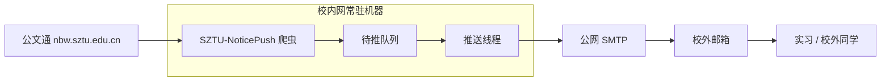
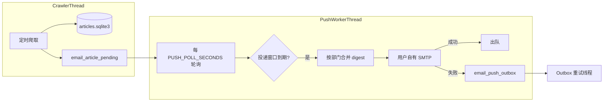

# SZTU-NoticePush

深圳技术大学校内公文通知的**爬取、展示与邮件推送**系统。在订阅页配置个人 SMTP 与推送频率后，可按部门聚合接收 HTML digest。

**仓库地址：** <https://github.com/OnePureLotus/SZTU-NoticePush>

> 本项目在 [Golden-Mouse](https://github.com/APLaS-Plus/Golden-Mouse) 基础上重构推送架构并扩展运维能力，详见文末 [鸣谢与 lineage](#鸣谢与-lineage)。

---

## 适用场景（为什么做这个项目）

深技大 [公文通](https://nbw.sztu.edu.cn/) 等校内资源通常要求处于**校园网**环境；在校外访问往往需要先通过**零信任**等门户认证，不方便随时刷通知。

本项目面向这样一种分工：

| 角色 | 环境 | 做什么 |
|------|------|--------|
| **爬取端** | 一台**长期在线、能直连校内网**的机器（宿舍小主机、实验室 PC、校内 VPS 等） | 运行本项目的爬虫与 Web 服务，定时抓取最新公文并入库 |
| **阅读端** | **校外**（实习、在家、出差等） | 不访问校内站，通过**个人邮箱**接收按部门聚合的 HTML 推送 |

邮件走公网 SMTP（QQ/163 等），相当于把「校内通知」**推送上云**到你的邮箱，在校外也能及时、完整地看到正文与附件链接。



**说明：**

- 爬虫进程需要能**稳定访问** `nbw.sztu.edu.cn`（一般即机器在校内网或等效可达环境）。
- 推送使用订阅页填写的**发件 SMTP + 收件邮箱**，不依赖零信任；若爬取端当时无法连外网 SMTP，失败会进入 **outbox**，外网恢复后自动补发。
- 请勿将服务暴露到公网供陌生人订阅；适合**个人或小范围同学自用**，并遵守学校与邮件服务商相关规定。

---

## 功能概览

| 模块 | 说明 |
|------|------|
| 爬虫 | 定时抓取 [深技大公文通](https://nbw.sztu.edu.cn/) 列表与正文，SQLite 持久化 |
| Web | 今日通知、历史归档、订阅管理（Flask + 静态页） |
| 邮件 | 按**部门（平台）**聚合的富 HTML digest，支持内嵌图与附件（体积受限） |
| 推送 | **生产者-消费者**：爬虫只入队，独立线程按频率投递，不漏不重 |
| 可靠性 | SMTP 失败写入 outbox 后台重试；异常写入 `logs/abnormal.log` |

---

## 架构说明

### 生产者-消费者推送



- **生产者（爬虫线程）**：发现新 URL 入库后，按订阅偏好写入每个用户的 `email_article_pending`（同一用户 + URL 唯一，避免重复入队）。
- **消费者（推送线程）**：服务启动后常驻，每隔 `PUSH_POLL_SECONDS`（默认 180 秒）检查队列；当用户**订阅频率**（如 3 小时）到期时开启**投递窗口**，在窗口时长内按部门合并发送；部门之间使用 `EMAIL_PUSH_INTERVAL_SECONDS` 间隔，降低 SMTP 限流风险。
- **窗口结束仍有积压**：关闭窗口并记录异常日志，下一周期继续消费，已发送文章不会再次入队。
- **Outbox**：外网 / 认证导致 SMTP 失败时持久化，独立线程指数退避重试；补发成功后再出队。

### 数据存储

| 文件 | 内容 |
|------|------|
| `database/articles.sqlite3` | 文章正文与元数据 |
| `database/subscribers.sqlite3` | 订阅者、平台、待推队列、outbox、投递窗口状态 |
| `logs/abnormal.log` | 仅异常事件（爬取/推送/SMTP 等），便于运维排查 |

---

## 快速开始

### 环境

- Python **3.8+**
- **爬取端**：能访问校内公文通（见上文 [适用场景](#适用场景为什么做这个项目)）
- **推送**：发件 / 收件邮箱可连公网 SMTP（如 QQ/163 授权码）

### 安装

```bash
git clone https://github.com/OnePureLotus/SZTU-NoticePush.git
cd SZTU-NoticePush

# 推荐 uv
uv sync

# 或 pip
python -m venv .venv
source .venv/bin/activate   # Windows: .\.venv\Scripts\Activate.ps1
pip install -r requirements.txt
```

### 启动

**推荐：Web + 自动爬虫 + 推送消费者 + outbox 重试**

```bash
python server.py --start-crawler
```

Windows 也可使用：

```powershell
.\start_with_crawler.ps1
```

仅 Web（在订阅页手动「启动自动爬虫」）：

```bash
python server.py
```

自定义监听：

```bash
python server.py --start-crawler --host 0.0.0.0 --port 5000
```

浏览器访问：<http://localhost:5000>

更细的部署步骤见 [DEPLOY.md](DEPLOY.md)。

---

## 使用说明

### 订阅邮件

1. 打开 **邮件订阅** 页，填写**收件邮箱**与**发件 SMTP**（服务器、邮箱、授权码）。
2. 保存时会验证 SMTP 并发送一封验证邮件；失败则不会写入数据库。
3. 选择「全部平台」或指定部门，设置 **推送频率（1–24 小时）**。
4. 在订阅页或启动参数中开启**自动爬虫**后，新公文会进入您的待推队列；到期后按部门收到 digest。

发件密码保存在本机 `subscribers.sqlite3` 明文，**仅适合个人/内网自用**，请勿将数据库提交到公开仓库。

### Web 页面

| 路径 | 说明 |
|------|------|
| `/` | 今日通知（首页） |
| 归档页 | 历史查询 |
| 订阅页 | SMTP、平台、频率、启动爬虫 |

---

## 配置

主要项在 [`config.py`](config.py)：

| 配置项 | 默认值 | 说明 |
|--------|--------|------|
| `SCHEDULED_CRAWL_HOURS` | `0.5` | 自动爬虫间隔（小时），约 30 分钟 |
| `PUSH_POLL_SECONDS` | `180` | 推送消费者轮询间隔（秒） |
| `EMAIL_PUSH_INTERVAL_SECONDS` | `300` | 同一用户多部门邮件之间的发送间隔 |
| `SUBSCRIBER_MASK` | 常见邮箱正则 | 允许订阅的收件邮箱格式 |
| `OFFICAL_URL` | `localhost:5000` | 邮件内「官网链接」用的对外地址 |
| `MAX_EMAIL_ATTACHMENT_MB` | `20` | 单封邮件附件体积上限 |

SMTP 端口默认 **587**（TLS），在 `config.py` 的 `SMTP_PORT` 中修改。

---

## API（节选）

| 方法 | 路径 | 说明 |
|------|------|------|
| GET | `/api/get_today_data` | 今日文章 |
| GET | `/api/get_data` | 分页归档 |
| GET | `/api/get_platforms` | 可订阅部门列表 |
| POST | `/api/subscribe` | 订阅 / 更新 |
| POST | `/api/start_crawl` | 启动自动爬虫 |
| GET | `/api/crawl_status` | 爬虫与推送消费者状态 |
| GET | `/api/push_outbox_stats` | 待推队列、outbox、投递窗口统计 |

---

## 运维与排错

```bash
# 队列 / 推送状态
curl http://localhost:5000/api/push_outbox_stats

# 异常日志（仅错误）
type logs\abnormal.log          # Windows
tail -f logs/abnormal.log       # Linux/macOS
```

**清空数据**（先停止 `server.py`）：

```bash
python clear_database.py --articles -y              # 仅文章库
python clear_database.py --reset-push-times -y      # 重置推送时间与投递窗口
python clear_database.py --clear-push-pending -y    # 清空待推队列
python clear_database.py --clear-push-outbox -y     # 清空 SMTP 失败队列
python clear_database.py --all -y                   # 文章 + 订阅者
```

**升级后补历史入队**（若此前漏推；可能重复，慎用）：

```bash
python backfill_push_queue.py --since 2025-10-01
```

**测试邮件**：

```bash
python send_test_email.py --to you@qq.com --subscriber-email you@qq.com --mode digest --limit 3
```

---

## 项目结构

```
SZTU-NoticePush/
├── server.py                 # Flask 入口、爬虫调度、线程启动
├── config.py                 # 统一配置
├── ops_abnormal_log.py       # 异常落盘
├── email_subscriber/         # 订阅 DB、推送生产者/消费者、SMTP、outbox
├── email_content/            # HTML digest 构建
├── official_document_crawler/# 公文通爬虫
├── static/                   # 前端页面
├── database/                 # SQLite（运行时生成，已 gitignore）
└── logs/                     # abnormal.log（运行时生成）
```

---

## 合规与免责声明

- 请遵守学校与公文发布方关于信息传播的规定；本项目仅供学习与个人便利，**不代表官方**。
- 请合理设置爬取间隔，避免对校内站点造成压力。
- 使用自有 SMTP 发送邮件时，须遵守邮件服务商条款与反垃圾邮件规范。

---

## 鸣谢与 lineage

本项目基于 **[Golden-Mouse](https://github.com/APLaS-Plus/Golden-Mouse)** 发展而来，感谢原作者在爬虫、订阅与 Web 展示方面的基础工作。

在源项目之上，SZTU-NoticePush 主要演进包括：

- 推送改为**生产者-消费者**模型（`email_article_pending` + 投递窗口 + 独立 `push_worker` 线程）
- 修复「爬取频率与推送频率错位导致漏推」类问题
- 外网 SMTP 失败 **outbox** 持久化与重试
- 运维向 **`logs/abnormal.log`** 与 `/api/push_outbox_stats` 等接口

若您在此基础上继续改进，欢迎在 README 或 PR 中保留对 [Golden-Mouse](https://github.com/APLaS-Plus/Golden-Mouse) 的引用。

---

## 许可证

[MIT](LICENSE)

---

## 贡献

欢迎 Issue / PR。提交前请确认未包含 `database/`、`.env` 或 SMTP 凭据。

### 从本仓库推送代码（维护者）

```bash
git remote add origin https://github.com/OnePureLotus/SZTU-NoticePush.git
git branch -M main
git push -u origin main
```

若本地已存在 `origin`，可改用：

```bash
git remote set-url origin https://github.com/OnePureLotus/SZTU-NoticePush.git
git push -u origin main
```
